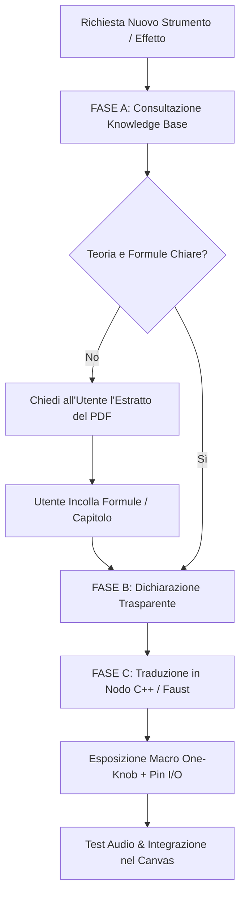

# 00_DSP_KNOWLEDGE_BASE: Enciclopedia e Mappa Metodologica DSP

Benvenuto nella **Knowledge Base DSP Ufficiale di MiMO**. Questo documento è l'indice concettuale e il protocollo metodologico vincolante per qualsiasi agente che progetti, scriva o rifattorizzi algoritmi di elaborazione numerica dei segnali audio (DSP), sintesi sonora ed effetti all'interno del progetto **MiMO Hub & Micro-DAW** (sia in codice **C++20 nativo su JUCE**, sia in codice **Faust DSP**).

---

## 1. Archivio Testi Accademici Locali

I testi integrali sono disponibili localmente nella cartella:  
📁 `H:\Il mio Drive\5. Programmazione MIMO\MiMO_Project\Documenti sulla musica\`

### 1.1 "DAFX: Digital Audio Effects" (Udo Zölzer)
- **File Locale:** [`Documenti sulla musica/DAFX - Digital Audio Effects (Udo Zolzer (ed)).pdf`](file:///H:/Il%20mio%20Drive/5.%20Programmazione%20MIMO/MiMO_Project/Documenti%20sulla%20musica/DAFX%20-%20Digital%20Audio%20Effects%20(Udo%20Zolzer%20(ed))%20(z-library.sk,%201lib.sk,%20z-lib.sk).pdf)
- **Dominio Principale:** Architetture classiche e moderne di effetti audio tempo-varianti, non-lineari e spettrali.
- **Mappa degli Argomenti:**
  - *Capitolo 2 (Delay Effects):* Linee di ritardo con interpolazione frazionaria (lineare, allpass, Lagrange) per Flanger, Chorus a più voci, Slapback Echo, Ping-Pong Delay e Vibrato pitch-shift.
  - *Capitolo 3 (Modulators & Demodulators):* Ring Modulation, Tremolo ad ampiezza controllata, simulazione altoparlante rotante Leslie con effetto Doppler e cross-over.
  - *Capitolo 4 (Nonlinear Processing):* Waveshaping analitico, saturazione a diodi/valvole (soft-clipping a funzioni iperboliche $\tanh(x)$ e polinomi di Chebyshev per distorsione armonica musicale).
  - *Capitolo 5 (Dynamics):* Compressori feed-forward e feedback, limiter a picco, noise gate ed expander con calcolo RMS/Peak detector ed envelope detector a doppio tempo di attacco/rilascio.
  - *Capitolo 6 (Time-Varying Filters):* Filtri Wah-Wah dinamici, Phaser polifasici a cascate di celle allpass del 1° ordine.
  - *Capitolo 7 (Spatial Effects):* Riverberi a pettine (Comb filters), Allpass Schroeder-Moorer e matrici di spazializzazione stereo/binaurale.

---

### 1.2 "Designing Audio Effect Plugins in C++" (Will C. Pirkle)
- **File Locale:** [`Documenti sulla musica/Designing Audio Effect Plugins in C++ (Will C. Pirkle).pdf`](file:///H:/Il%20mio%20Drive/5.%20Programmazione%20MIMO/MiMO_Project/Documenti%20sulla%20musica/Designing%20Audio%20Effect%20Plugins%20in%20C%2B%2B%20For%20AAX,%20AU,%20and%20VST3%20with%20DSP%20Theory%20(Will%20C.%20Pirkle)%20(z-library.sk,%201lib.sk,%20z-lib.sk).pdf)
- **Dominio Principale:** Traduzione pragmatica delle formule matematiche in classi C++ per elaborazione a blocchi di campioni (`processBlock`).
- **Mappa degli Argomenti:**
  - *Filtri Biquad Diretti (RBJ Cookbook):* EQ parametrici (Peaking, Low-Shelf, High-Shelf, Notch, Bandpass) con ricalcolo ottimizzato dei coefficienti.
  - *Anti-Aliased Oscillators:* Algoritmi PolyBLEP (Band-Limited Step/Ramp) per generare onde dente di sega, quadre e triangolari senza ripiegamento in banda (aliasing) anche ad alte frequenze.
  - *Envelope Generators (ADSR):* Implementazione a stati con andamenti esponenziali musicali analog-modeled per attacchi percussivi veloci e code morbide.
  - *Parameter Smoothing:* Interpolazione a un polo (One-Pole Low-Pass Filter) sui valori dei parametri per eliminare qualsiasi click o "zipper noise" durante il trascinamento delle manopole su schermo.

---

### 1.3 "The Art of VA Filter Design" (Vadim Zavalishin)
- **File Locale:** [`Documenti sulla musica/THE ART OF VA FIlter.pdf`](file:///H:/Il%20mio%20Drive/5.%20Programmazione%20MIMO/MiMO_Project/Documenti%20sulla%20musica/THE%20ART%20OF%20VA%20FIlter.pdf)
- **Dominio Principale:** Il testo sacro per la sintesi Virtual Analog e i filtri risonanti ad alta precisione matematica.
- **Mappa degli Argomenti:**
  - *TPT (Topology-Preserving Transform):* Discretizzazione conforme mediante trasformazione bilineare preservando la topologia integratrice analogica senza introdurre ritardi artificiali.
  - *ZDF (Zero-Delay Feedback):* Risoluzione algebrica istantanea del loop di retroazione senza ritardo di 1 campione ($z^{-1}$), garantendo perfetta risposta in frequenza e stabilità assoluta anche a frequenze di taglio vicine alla frequenza di Nyquist.
  - *State Variable Filter (SVF) 12dB/oct:* Architettura a due integratori con uscite simultanee Low-Pass, Band-Pass, High-Pass, Notch e All-Pass, controllate con risonanza $Q$ continua ed esente da instabilità numerica.
  - *Moog Ladder 24dB/oct a 4 Poli:* Modello a cascata con saturazione non-lineare incorporata nel loop, per il classico suono caldo e grasso dei synth vintage.
  - *Diode Ladder 18dB/24dB:* Modello non lineare per filtri stile Roland TB-303 / EMS VCS3.

---

### 1.4 "Physical Audio Signal Processing" (Julius O. Smith III - CCRMA Stanford)
- **File Locale:** [`Documenti sulla musica/Physical Audio Signal Processing (Julius O. Smith III).pdf`](file:///H:/Il%20mio%20Drive/5.%20Programmazione%20MIMO/MiMO_Project/Documenti%20sulla%20musica/Physical%20Audio%20Signal%20Processing%20for%20Virtual%20Musical%20Instruments%20and%20Digital%20Audio%20Effects%20(Julius%20O.%20Smith%20III)%20(z-library.sk,%201lib.sk,%20z-lib.sk).pdf)
- **Dominio Principale:** Modelli fisici acustici di strumenti e riverberi algoritmici ad alta densità.
- **Mappa degli Argomenti:**
  - *Digital Waveguide Mesh:* Simulazione a guida d'onda digitale per corde percosse (chitarre, pianoforti, kalimbe) con dispersione ed estinzione naturale dell'energia.
  - *Modelli di Percussioni & Membrane 2D:* Ideale per il nostro **Modulo Batteria (Pico Drum)**: generazione di grancasse acustiche, tom e piatti tramite equazioni di Bessel e linee di ritardo bidimensionali eccitate da impulsi piezoelettrici.
  - *Feedback Delay Networks (FDN):* Matrici ortogonali unitarie (Hadamard, Householder) a $N$ ritardi per creare riverberi ampi, tridimensionali e privi di risonanze metalliche, con controllo rigoroso del tempo di riverberazione $T_{60}$ per frequenza.

---

## 2. Repository Open-Source di Riferimento ("Masterpiece Code")

Per apprendere le migliori tecniche di architettura software, ottimizzazione C++ e sintesi macro:

### 2.1 Mutable Instruments (Émilie Gillet)
- **Repository:** `https://github.com/pichenettes/eurorack`
- **Cosa studiare e replicare:**
  - `eurorack/plaits/dsp/`: Il punto di riferimento per la sintesi macro di MiMO. Come strutturare 16 motori sonori diversi controllati da sole 3 macro semantiche (`harmonics`, `timbre`, `morph`).
  - `eurorack/clouds/dsp/`: Motore granulare, pitch shifting lofi ed effetto di riverbero diffuso a cascata di allpass con consumo CPU ridottissimo.
  - `eurorack/elements/dsp/`: Sintesi per risonatori modali e modelli fisici di corde ed archi.
  - `eurorack/ripples/` & `shelves/`: Design di filtri analogici discreti.

### 2.2 Surge XT Synthesizer
- **Repository:** `https://github.com/surge-synthesizer/surge`
- **Cosa studiare e replicare:**
  - Matrice di modulazione polifonica ultra-flessibile (collegamento di LFO, inviluppi, e controller MPE ai parametri sonori).
  - Gestione del processamento SIMD/SSE/AVX per eseguire oscillatori complessi senza consumare cicli CPU.

---

## 3. Protocollo Operativo Vincolante per l'Agente `@AUDIO`

Quando all'agente `@AUDIO` viene richiesto di implementare o migliorare un algoritmo sonoro:

### FASE A: Consultazione & Scelta della Base Teorica
Prima di scrivere qualsiasi riga di codice, `@AUDIO` consulta questa mappa e stabilisce:
1. Quale testo accademico o repository fa da fondamento alla richiesta.
2. La topologia esatta dell'algoritmo (es. Zavalishin TPT/ZDF SVF per filtri; Zölzer Cap. 2 per Delay; Julius O. Smith FDN per riverberi; Émilie Gillet Plaits per i synth macro).

### FASE B: Dichiarazione Trasparente e Richiesta di Verifica
`@AUDIO` deve dichiarare esplicitamente all'utente:
> *"Per questo effetto/strumento utilizzerò l'architettura descritta in **[Nome Autore e Libro/Capitolo]**. Sto attingendo ai miei dati di addestramento su questo autore."*
- **Regola di Sicurezza Numerica:** Se l'agente non è sicuro al 100% dell'esatta formulazione algebrica di un coefficiente o di una matrice di scattering, **deve fermarsi e chiedere all'utente di incollare il testo/estratto del capitolo corrispondente dal PDF locale**, evitando formule approssimate o instabili.

### FASE C: Traduzione in Nodo Modulare per il Canvas di MiMO
Il codice generato (in C++20 nativo per `mimo_hub_juce` o in Faust) deve soddisfare i requisiti del nostro Canvas Modern Flat:
1. **Macro Semantiche "One-Knob":** Non sommergere l'interfaccia con decine di parametri matematici interni. Esponi solo 2-4 macro ad alto valore musicale (es. *Cutoff, Resonance, Space, Color, Punch*), mappate internamente sui coefficienti DSP.
2. **Pin di Interfaccia Standardizzati:**
   - `Trigger In`: Per colpi del Modulo Batteria e pinch del Modulo Occhio.
   - `Mod In (CV)`: Per coordinate $X, Y, Z$ dell'Occhio o inviluppi continui ($0.0 - 1.0$).
   - `Audio In / Audio Out`: Flussi audio stereo normalizzati $[-1.0, +1.0]$.
3. **Protezione Denormal & Anti-Click:**
   - Interpolare sempre i cambi di parametro con filtri one-pole per evitare zipper noise.
   - Attivare la soppressione dei numeri denormalizzati (`JUCE_SNAP_TO_ZERO` o flag SSE flush-to-zero) per prevenire picchi CPU improvvisi durante i silenzi.
